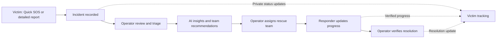

# RescueGrid AI 🚨

### AI-assisted disaster reporting, rescue coordination, and incident tracking

**Built for Nexathon 2026** | Hackathon prototype

RescueGrid AI is a web-based disaster-response coordination platform that connects people reporting emergencies with operators and rescue teams. It combines a quick location-based SOS flow, an incident management dashboard, AI-assisted analysis, team recommendations, and secure status tracking into one coordinated workflow.

> [!IMPORTANT]
> **Demonstration system — not an official emergency service.** RescueGrid AI is a hackathon prototype and is **not** connected to government emergency dispatch or emergency responders. In India, call **112** for a real emergency. Do not rely on this application for life-critical assistance.

## The problem

During floods, fires, and other disasters, emergency information can be incomplete, duplicated, or spread across different channels. Victims may not be able to type a detailed report, while coordinators must evaluate urgency, locate available teams, and track progress.

## Our solution

RescueGrid AI provides a shared workflow for three key roles:

- **Victim / reporter:** Submit a detailed report or Quick SOS, optionally provide a contact number, and privately track the incident.
- **Operator:** Review incoming incidents, triage incomplete SOS requests, inspect the Rescue Map, assess AI-assisted insights, assign rescue teams, and verify completion.
- **Admin:** Manage rescue teams, their locations, and operational capabilities.
- **Responder:** View assigned work, update rescue progress, and submit a completion report for operator review.

AI **assists** the process; it does not independently dispatch teams or close incidents.

## Key features

| Feature | Description |
| --- | --- |
| **Quick SOS** | One-tap emergency reporting with browser-based location permission and a fallback for manually entered location details. |
| **Detailed emergency reports** | Provide incident information, including an optional contact number. |
| **Operator triage** | Review Quick SOS reports whose incident type or severity has not yet been established. |
| **AI-assisted analysis** | Google Gemini is the primary AI provider, with Groq as a fallback where configured. |
| **Duplicate incident review** | Identify potentially related incident reports for human review. |
| **Rescue Map** | Visualize reported incidents, including markers at shared coordinates. |
| **Team recommendations** | Assist operators using rescue-team capabilities and proximity. |
| **Human-controlled assignment** | Operators make the final assignment decision. |
| **Responder workflow** | Track response stages and submit completion details. |
| **Verified resolution** | Operator reviews the responder's completion report before final resolution. |
| **Private victim tracking** | Follow incident status using a private tracking token, with a unified **Your SOS Status** view. |
| **Role-based access** | Separate workflows for admins, operators, and responders. |

### End-to-end workflow



## Technology stack

| Layer | Technologies |
| --- | --- |
| Victim portal | React, Vite |
| Rescue dashboard | React, Vite |
| Backend API | Node.js, Express |
| Database | PostgreSQL |
| Authentication | JWT-based role access |
| AI integration | Google Gemini; Groq fallback |
| Maps and location | Browser Geolocation API and interactive incident mapping |
| Development tools | VS Code, Git, GitHub |

## Repository structure

```text
Ai-Disaster-management-Nexathon/
├── backend/             # Express API, database access, migrations
├── emergencyfrontend/   # Victim reporting and secure SOS tracking
├── rescue-dashboard/    # Admin, operator, and responder interfaces
└── README.md
```

## Run locally

### Prerequisites

- Node.js and npm
- PostgreSQL running locally
- A PostgreSQL database configured for the backend
- API provider credentials if you want to demonstrate AI-assisted features

### 1. Clone the repository

```bash
git clone <YOUR-REPOSITORY-URL>
cd Ai-Disaster-management-Nexathon
```

Replace `<YOUR-REPOSITORY-URL>` with your GitHub repository's clone URL.

### 2. Configure the backend

From the repository root:

```bash
cd backend
npm install
```

Create a **local** `backend/.env` with the PostgreSQL connection, JWT secret, port, and AI provider credentials expected by `backend/src/config/env.js`. Refer to the source configuration for the exact variable names; do **not** commit the `.env` file.

Create and configure the PostgreSQL database before applying migrations:

```bash
npm run db:migrate
```

Start the API:

```bash
npm run dev
```

The default local API address in the current demo setup is **http://localhost:4000**.

Check its health at **http://localhost:4000/api/health**. A healthy response confirms the API is up and PostgreSQL is connected.

> If port **4000** is already occupied by a healthy RescueGrid API process, keep using it rather than starting a duplicate backend.

### 3. Start the victim portal

In a **new terminal**, from the repository root:

```bash
cd emergencyfrontend
npm install
npm run dev
```

Open **http://localhost:5173**.

### 4. Start the rescue dashboard

In another **new terminal**, from the repository root:

```bash
cd rescue-dashboard
npm install
npm run dev
```

Open **http://localhost:3000**.

> Keep the backend and both frontend terminals running simultaneously. If your Vite configuration reports a different port, use the URL printed in its terminal.

### 5. Demo the full rescue workflow

1. In the **victim portal**, submit a test Quick SOS and allow location access (or provide the location manually when prompted).
2. Copy the incident reference and keep its private tracking token safe.
3. In the **operator dashboard**, locate the incoming incident on the Rescue Map.
4. Triage the incident, review suggested teams, and manually assign an appropriate team.
5. Sign in as the assigned **responder** in a separate browser profile and update progress.
6. Review the completion report and verify the outcome as an operator.
7. Return to the victim portal and refresh **Your SOS Status**.

For a multi-role demonstration, use separate browser profiles so login sessions do not overwrite one another. Demo accounts, if seeded locally, should remain **out of this public README**.

## Testing and validation

At the final hackathon checkpoint (`7c472f6`), the local project reported:

| Component | Automated tests | Additional checks |
| --- | ---: | --- |
| Backend | **100 passing** | Server syntax checks passed |
| Rescue dashboard | **43 passing** | Lint and production build passed |
| Victim frontend | **48 passing** | Production build passed |
| **Total** | **191 passing** | |

These results were reported for the checked-in version; run the relevant package scripts again after making changes. A complete end-to-end browser walkthrough is still recommended.

## Security and privacy notes

- Keep PostgreSQL passwords, Gemini/Groq API keys, JWT secrets, and other credentials in ignored local environment files.
- Never commit `.env` files, database dumps, access tokens, or real emergency contact information.
- Victim tracking uses a **private token**. Treat it as sensitive and do not publish it in URLs, screenshots, or logs.
- Optional contact numbers are intended for authorized operational use, not public incident tracking.
- AI output should always be reviewed by a human operator before operational decisions.
- Location access depends on user permission and browser security requirements.
- Demo credentials and example incident data are **not** suitable for production use.

## Limitations

- This is a **local hackathon prototype**, not a deployed emergency-response service.
- Rescue dispatch is simulated within the platform; it is not integrated with official emergency authorities.
- GPS accuracy and connectivity depend on the user's device, permissions, and network conditions.
- Quick SOS does **not** currently provide a guaranteed offline delivery queue.
- Automated tests do not replace real-world safety, load, security, or usability validation.

## Future improvements

- **Android application** using Capacitor and Android Studio, with native device integration.
- **Offline-first SOS queue** with clear pending/delivered states, reconnection handling, and server-side idempotency.
- **Secure cloud deployment** with HTTPS and production monitoring.
- **Real-time notifications** for victims, operators, and responders.
- **Authorized integrations** with verified emergency services and disaster-management organizations.
- **Field testing and accessibility improvements** for low-connectivity and high-stress scenarios.

## Project outcome and intended impact

RescueGrid AI demonstrates how a shared incident workflow can **potentially** reduce information fragmentation, support faster reporting, help coordinators choose suitable teams, and provide clearer status updates to affected people. These are proposed benefits of the prototype, **not measured real-world response-time improvements**.

## Hackathon

**Event:** Nexathon 2026  
**Project:** RescueGrid AI  
**Team:** Savio, Subhash, Satwik, and Akash  
**Status:** Local demonstration prototype

---

**Built to explore safer, clearer, and more coordinated disaster-response workflows — with humans making the critical decisions.**
